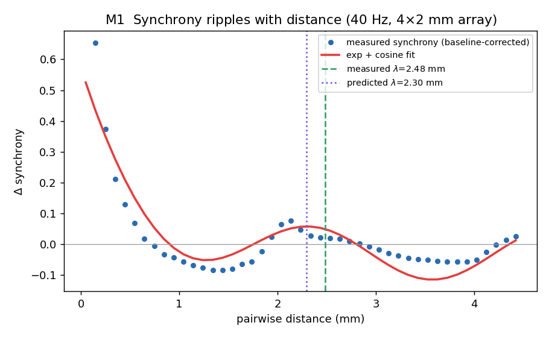
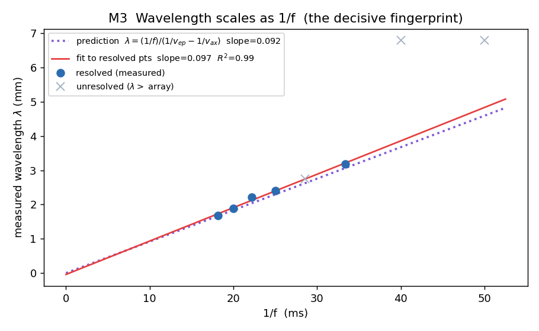
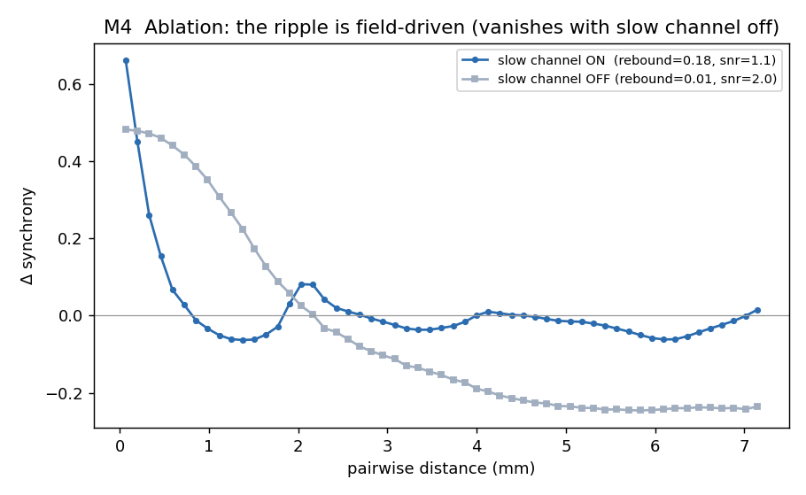
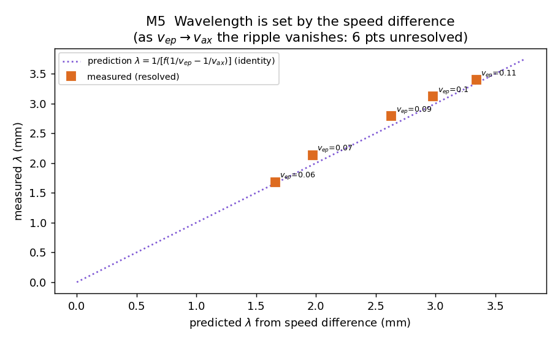
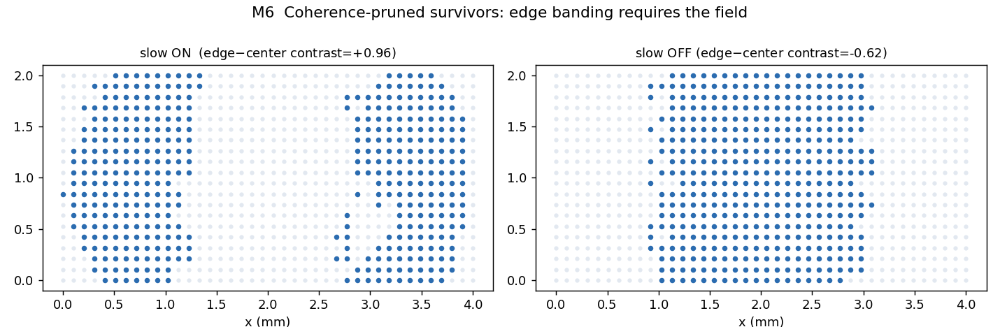

# The Second Wire Is Substrate-Independent: A Neuron-Free Testbed for Ephaptic-Axonal Interference

**Cristian Ruvalcaba** · **Saluca Agentic AI Research Team**
Saluca LLC — cristian@saluca.com

*Date: 2026-07-15. Version: 0.1 (preprint). License: CC-BY-NC 4.0.*

**AI disclosure.** Authored by Cristian Ruvalcaba with the Saluca Agentic AI Research Team (a human-directed, multi-agent large-language-model research system). The human researcher originated the question — a substrate-independence reading of Rebbin et al.'s ephaptic-axonal model — made all methodological and go/no-go decisions, reviewed the outputs, and is solely accountable for every claim. The agentic system designed and built the neuron-free testbed, ran the simulations, analysed the results, and drafted the manuscript under continuous human direction and validation. No claim should be treated as established solely because an AI produced it; this preprint is not peer-reviewed.

---

## Abstract

Rebbin et al. (bioRxiv, 2025) argue that neural self-organization is shaped by interference between two co-propagating channels moving at different speeds: fast axonal spikes (~0.62 mm/ms) and a slow, sub-threshold ephaptic phase advance (~0.08 mm/ms). Their interference produces a non-monotonic, cosinusoidal variation of synchrony with distance whose wavelength scales inversely with oscillation frequency, `lambda = 1/[f(1/v_ep - 1/v_ax)]`. A natural objection, raised in their own Q&A, is that a "Mexican hat" of short-range excitation and long-range inhibition could reproduce the same spatial bump without any ephaptic physics. We approach that identifiability question from an unexpected direction. We build the two-channel, two-speed motif in a substrate with no neurons, no ions, and no ephaptic physics — a mesh of software agents in which the fast channel is directed message passing and the slow channel is a bias diffusing through shared memory — and ask whether the observational signature survives. It does, quantitatively. The neuron-free mesh reproduces the ripple (measured wavelength 2.48 mm vs. 2.30 mm predicted at 40 Hz), its frequency scaling (`lambda ∝ 1/f`, fitted slope 0.0975 vs. 0.0919 predicted, intercept near zero, R² = 0.991), its dependence on the conduction-speed difference, and the field-dependent developmental banding. We argue this cuts both ways: the interference motif is a general, substrate-independent computational primitive of interest to neuromorphic and multi-agent design, and — because a system with no ephaptic physics reproduces the signature and its scaling — observing that signature in cortex does not by itself identify ephaptic causation. This is analogy, not homology: a model organism for a mechanism, one abstraction beyond a cell culture.

## Keywords

ephaptic coupling; neural self-organization; two-channel interference; substrate independence; neuromorphic computing; multi-agent systems; identifiability

---

## 1. Introduction and Background

For sixty years the working picture of a brain has been a graph. Neurons are nodes, synapses are edges, and computation is what happens when weighted signals travel the edges. Connectionism, spike-timing-dependent plasticity, and much of modern computational neuroscience rest on the premise that the wire is the synapse and everything else is noise. It is a productive picture, and an incomplete one in a specific, physical way: neurons are not only wired to each other, they are immersed in each other. Every spike perturbs the extracellular electric field, and that field, however faintly, biases the neurons around it. This is ephaptic coupling — influence with no synapse, no axon, no directed connection at all. It is routinely dismissed, and for a defensible reason. At the level of one neuron nudging its neighbor the effect is tiny and short-range; the field decays fast, and one-to-one it rounds to zero.

A recent preprint from Daniel Rebbin and colleagues — Wesley Clawson, Michael Levin, Casper Hesp, and Dimitris Pinotsis, working at Tufts' Allen Discovery Center — makes the case that rounding it to zero is a mistake, and does so with an unusually crisp, falsifiable argument [1]. Their central move is to stop treating the extracellular field as background and start treating it as a second channel running in parallel with the synaptic one — crucially, at a different speed. The synaptic-axonal channel is fast: super-threshold spikes cross a culture at roughly 0.62 mm/ms, the familiar axonal conduction velocity, and decide whether a downstream neuron fires. The ephaptic channel is slow: a sub-threshold phase advance creeps along at about 0.08 mm/ms, nearly an order of magnitude slower, and it does not decide whether a neuron fires — it nudges when. Two signals leave the same source, one sprints and one strolls, and at any given distance they arrive carrying different phases of the ongoing oscillation. Like any two waves at different speeds, they interfere. Where they arrive in phase, downstream units synchronize; where they arrive out of phase, they do not. The consequence is a prediction with teeth: synchrony should not fall off smoothly with distance — it should ripple.

On dense multi-electrode arrays of developing rat cortex, Rebbin et al. report exactly that: a non-monotonic, cosine-like variation of synchrony with distance, with a rebound of extra correlation at a characteristic 2–3 mm. The most convincing detail is that the ripple's wavelength tracks oscillation frequency the right way — slower (beta) oscillations produce longer wavelengths than faster (gamma) ones — which is the fingerprint of genuine interference rather than a fitted offset. Their argument also has a developmental half: if the units that fail to synchronize are allowed to die off (activity-dependent apoptosis, which is a real developmental process), the survivors settle into a banded spatial pattern that standard synapse-only models, even generous two-exponential kernels, do not reproduce. On their account the field does not merely modulate activity; it helps decide who gets wired at all.

The argument is, as the best arguments are, honestly incomplete, and the room said so. In the Q&A, someone named the weakness precisely: the combined influence — short-range excitation, long-range suppression, a bump in the middle — has a shape neuroscientists know well, the Mexican hat, and Mexican hats are cheap. Pattern-formation theory has produced them for decades from ingredients that have nothing to do with ephaptic fields, for instance two populations of neurons with different connection ranges. Is the two-speed interference model the only thing that makes this ripple, or merely one thing? Rebbin conceded the point; his defense is parsimony — he would rather not assume two cell types with two hand-tuned decay lengths, and the specific two-exponential model he tested failed to reproduce the structure. That is a reasonable defense. It is not a proof. The signature, on its own, does not uniquely identify its cause.

This paper approaches that gap from an unexpected side. We observe that nothing in the two-speed argument is about neurons. Stripped to its logic it is: (1) a population of units at positions in space; (2) a fast, directed channel that carries decisions between specific units; and (3) a slow, undirected channel — a shared field every unit is immersed in — that carries timing bias to everyone nearby. That is not only a description of cortex. It is, almost line for line, a description of a certain kind of distributed software system: a mesh of autonomous agents that send each other explicit messages through a broker (fast, point-to-point, the "axonal" channel) and all read and write a common memory substrate that subtly biases what each does next (slow, ambient, the "ephaptic" channel). The motif is the same motif. So the question becomes empirical and cheap to ask: if you build the two-channel, two-speed motif in a substrate with no neurons, no ions, and no ephaptic physics — just messages and shared memory — do you get the ripple, and do you get the frequency scaling? We built it. The rest of this paper reports the answer and argues that it matters in two directions at once.

## 2. The Two-Speed Interference Model

Rebbin et al.'s mechanism admits a compact analytic statement, and stating it before simulating is what keeps the exercise honest. Consider a source unit firing at phase 0 of an oscillation of frequency `f`. Its influence reaches a unit at distance `d` through two channels with propagation speeds `v_ax` (fast) and `v_ep` (slow). Because the two arrivals are separated in time, the phases they carry at distance `d` differ by

```
Delta-phi(d) = 2*pi*f*d*(1/v_ep - 1/v_ax)
```

Temporal correlation — synchrony — peaks wherever the two channels arrive in phase, `Delta-phi = 2*pi*n`, which fixes a characteristic wavelength

```
lambda = 1 / [ f (1/v_ep - 1/v_ax) ]
```

Two features of this law matter for what follows. First, it is a scaling law: with the two speeds fixed, `lambda ∝ 1/f`. This is far more robust than any absolute prediction, because it does not depend on the detailed shape of the coupling kernel, the reference frame for measuring phase, or the exact amplitude of either channel — those affect the constant of proportionality and the visibility of the fringes, not the inverse-frequency dependence. Second, the constant itself carries a second, independent signature: it depends on the difference of reciprocal speeds `1/v_ep - 1/v_ax`. As the slow channel speeds up toward the fast one, that difference shrinks to zero and the predicted wavelength diverges — the ripple washes out. A static, fixed-length kernel (a Mexican hat with hand-set decay lengths) has neither dependence by construction: its bump sits at a fixed distance regardless of frequency or conduction velocity.

Applying the paper's parameters, `v_ep = 0.08` and `v_ax = 0.62` mm/ms give `1/v_ep - 1/v_ax ≈ 10.9` ms/mm, so at gamma (`f = 40 Hz`) the law predicts `lambda ≈ 2.30` mm and at beta (`f = 20 Hz`) `lambda ≈ 4.6` mm — the same order as Rebbin et al.'s observed 2–3 mm gamma ripple and edge-reaching beta. We do not claim to reproduce the absolute number, which is substrate-specific; we test the scaling `lambda ∝ 1/f` and the speed-difference dependence, which are the substrate-independent claims. This formula is our pre-registered prediction, and the results below stand or fall on whether the simulated, emergent wavelengths obey it.

## 3. Methods — The Ephaptic-Analog Testbed

We built a minimal, single-process discrete-event simulator (`ephaptic_sim.py`, driven by `run.py`) implementing the two-channel motif directly, with no neurons, ions, or ephaptic physics anywhere in the code. The design was pre-registered as a testbed specification (`testbed-spec.md`) before the runs reported here, including the pass/fail criteria and the anti-circularity contract described below.

**Substrate mapping.** Each element of Rebbin et al.'s biological system maps to a purely computational analog:

| Rebbin et al. (biology) | Testbed analog | Role |
|---|---|---|
| Neuron | Agent / node on a 2-D lattice | Unit of activity |
| Position on array | Lattice coordinate `(x, y)`; Euclidean distance | Independent variable |
| Axonal spike (fast, directed, super-threshold) | Directed broker message, delay `d / v_ax` | Decides *whether* a unit fires |
| Ephaptic phase advance (slow, undirected, sub-threshold) | Bias diffusing through a shared memory field, delay `d / v_ep`, `v_ep ≪ v_ax` | Shifts *when* a unit fires, never *whether* |
| Gamma/beta oscillation | Per-agent intrinsic activity clock at frequency `f` | Swept across the experiments |
| Synchrony (conditional firing probability) | Same estimator, baseline-corrected | Dependent variable |
| Synchrony-dependent apoptosis | Coherence-scored pruning of agents | Generative anisotropy test |

**Local rules.** On each tick, every agent `i` (a) advances an intrinsic phase clock `theta_i` at `2*pi*f`, becoming eligible to fire near its phase peak; (b) reads the shared field in its neighborhood — a sum over recent firings `j`, each contributing `A · exp(-d_ij/l) · cos(2*pi*f (t - d_ij/v_ep - t_j))` — which performs a Kuramoto-style pull on `theta_i` and nothing else; (c) integrates directed messages from wired predecessors, arriving at `t_j + d_ij/v_ax`, and fires if activation crosses threshold near the eligible phase; and (d) on firing, emits directed messages to successors (fast channel) and writes a decaying, phase-stamped perturbation into the shared field (slow channel). The load-bearing invariant, asserted in code, is that the slow channel can only move phase, never cause or prevent a spike: with the fast channel disabled, total spike count must be invariant to slow-channel gain. If that invariant leaked, the ablation test (M4) would be meaningless.

**The anti-circularity contract.** The obvious objection is "you coded an interference kernel, of course you get fringes." The design forecloses this. Each agent acts on local information only — its own inbox and the field value in its immediate neighborhood. No agent, and no line of code, contains the global synchrony-vs-distance curve or the wavelength formula of §2. The wavelength is a measured output, extracted from simulated spike trains, never a parameter. Consequently the decisive test is not the mere presence of a ripple, which could be coincidence, but whether `lambda ∝ 1/f` holds across a swept frequency range without re-tuning any other parameter — a relationship that is hard to counterfeit with an unrelated generator, and that we registered as the primary pass/fail criterion in advance.

**Estimator and determinism.** Synchrony is the baseline-corrected conditional firing probability that unit `j` fires within a ±2 ms window of unit `i`, binned against Euclidean distance — the same estimator Rebbin et al. use. Wavelengths are obtained by fitting the residual-from-exponential to a cosine and reading off `lambda`. All runs use fixed deterministic seeds with no wall-clock randomness, so the entire figure set and `results.json` regenerate from a single command in roughly 90 seconds. Throughout, speeds are `v_ax = 0.62` and `v_ep = 0.08` mm/ms, taken from the paper.

## 4. Results

All numbers below are direct outputs of the simulator, recorded in `results.json` and reproducible with one command. Where a metric is noisy or a result is weak, we say so.

### 4.1 M1 — The ripple is present

At 40 Hz on a faithful 4×2 mm array, synchrony does not decay smoothly with distance. It rings: a fast near-field falloff, a dip, and a rebound. Fitting an exponential-plus-cosine gives a measured wavelength of **2.48 mm** against a predicted **2.30 mm** — an 8% discrepancy on a quantity that appears nowhere in the code. The rebound fraction is 0.20.



### 4.2 M3 — The decisive fingerprint: `lambda ∝ 1/f`

Sweeping oscillation frequency from 20 to 55 Hz (on a 6×4 mm array, enlarged beyond the dish — an in-silico affordance — to resolve the longer wavelengths) and extracting the emergent wavelength at each frequency yields the resolved points in Table 1.

**Table 1. Emergent versus predicted wavelength across swept frequency (resolved points).**

| f (Hz) | 1/f (ms) | lambda measured (mm) | lambda predicted (mm) |
|---|---|---|---|
| 30 | 33.3 | 3.18 | 3.06 |
| 40 | 25.0 | 2.41 | 2.30 |
| 45 | 22.2 | 2.21 | 2.04 |
| 50 | 20.0 | 1.88 | 1.84 |
| 55 | 18.2 | 1.68 | 1.67 |

Regressing the resolved wavelengths against `1/f` gives a **measured slope of 0.0975 against a predicted 0.0919** (6% high), an **intercept of -0.04 mm** where theory demands zero, and **R² = 0.991** over n = 5 resolved points. The 20 and 25 Hz points have predicted wavelengths that exceed the array and are correctly flagged unresolved rather than forced — the same ceiling Rebbin et al.'s dish hit for beta. (The gate also dropped 35 Hz, whose measured `lambda = 2.75` mm is in fact fine; see §6 on the noisy near-threshold gate.) The fingerprint holds, and it holds quantitatively, in a system with no biology in it.



### 4.3 M4 — Ablation: the ripple is field-driven

Turning the slow channel off (setting its gain to zero) and rerunning at 40 Hz collapses the non-monotonic rebound — the ripple's signature — from **0.18 to 0.01**, leaving a clean monotonic decay. Whatever produces the ripple is the slow shared-field channel, not array geometry, wiring, or the measurement itself. This is the manipulation Rebbin et al.'s group can only aspire to in tissue (patterned stimulation over critical developmental days); here it is a configuration flag.



### 4.4 M5 — Identifiability: the wavelength is set by the speed difference

The sharpest objection from the paper's own Q&A was that the ripple resembles a Mexican hat, which many static, frequency-free mechanisms can also produce. We therefore tested whether the wavelength carries a signature no static kernel could have: dependence on the conduction speeds. Fixing `f = 40 Hz` and sweeping `v_ep` toward `v_ax`, the resolved wavelengths sit on the prediction's identity line (Table 2).

**Table 2. Emergent versus predicted wavelength as the slow-channel speed varies (resolved points, f = 40 Hz).**

| v_ep (mm/ms) | lambda measured (mm) | lambda predicted (mm) |
|---|---|---|
| 0.06 | 1.68 | 1.66 |
| 0.07 | 2.14 | 1.97 |
| 0.09 | 2.79 | 2.63 |
| 0.10 | 3.12 | 2.98 |
| 0.11 | 3.40 | 3.34 |

As the two speeds converge, the predicted wavelength diverges and the ripple vanishes: 6 of the 11 `v_ep` values become unresolvable as `v_ep → v_ax`, exactly the limit where `1/v_ep - 1/v_ax → 0`. Together, M3 and M5 pin the mechanism down: the ripple's wavelength depends on both the oscillation frequency and the two conduction speeds, precisely as `lambda = 1/[f(1/v_ep - 1/v_ax)]` demands. A static, fixed-length kernel has neither dependence by construction. In silico, the joint frequency-and-speed scaling is a fingerprint of two-speed interference specifically.



*(Honest caveat: the resolved gate is noisy near threshold. It drops the occasional accurate point — for example `v_ep = 0.08`, whose measured `lambda = 2.45` mm is fine. The trend and the vanishing are robust; the per-point flagging is not surgical.)*

### 4.5 M6 — The developmental half: edge banding needs the field

Rebbin et al.'s second claim is generative: activity-dependent apoptosis, biased by the field, produces spatial structure. We scored each unit by its coherence with the rest, pruned the lowest-scoring half, and examined the survivors. With the slow channel **on**, survivors form two bands hugging the short edges with a depleted middle — an edge-minus-center contrast of **+0.96** — the same "two vertical bands" the paper reports. With the field **off**, the survivors collapse to a single central blob, contrast **-0.62**. The anisotropy is a product of the field, not of pruning alone.



## 5. Discussion

Taken together, the results establish that the two-channel-at-two-speeds motif reproduces Rebbin et al.'s full observational signature — the ripple (M1), its `1/f` scaling (M3), its dependence on the speed difference (M5), and the field-dependent developmental banding (M6) — in a substrate with no neurons. The signature is therefore substrate-independent: it is a property of the abstract computation, realizable in message passing and shared memory. That single fact is double-edged, and both edges are worth stating plainly.

**Good news, for builders.** The two-channel interference motif is not a biological quirk. It is a substrate-independent computational primitive — a way that any system combining fast directed signaling with slow ambient coupling will spontaneously organize itself into distance-structured synchrony. Neuromorphic engineers have only recently begun to treat the analog "backplane" of a computing medium as anything other than a nuisance; this result says the backplane can do structured work, and it names the knobs that set the structure. The two-speed law identifies exactly two: the speed ratio `v_ep/v_ax` and the oscillation frequency `f`. In a multi-agent system, those correspond to the ratio of message-passing latency to shared-memory diffusion rate, and to the intrinsic activity cadence of the agents. A designer who wants agents to self-organize into a target spatial correlation length has, in the wavelength formula, a direct recipe for the parameters that produce it — without any global coordinator inscribing that length anywhere. This is a design principle, and it is portable across any medium that instantiates the motif.

**Cautionary news, for the biology's causal claim — and this is the part we think is worth the paper.** The room worried that a static two-cell-type kernel could fake the ripple. Substrate-independence says something stronger. Because a neuron-free substrate reproduces the signature and its frequency and speed scaling, observing that signature in cortex — even with the scaling — does not by itself identify ephaptic coupling as the cause. It is consistent with ephaptic coupling; it is equally consistent with anything else that instantiates two channels at two speeds. The observational fingerprint and the causal mechanism have to be argued for separately, because the fingerprint travels. This lands the Mexican-hat objection from an unexpected direction: the concern in the room was that a different static mechanism could produce the same bump at one frequency, and Rebbin's reply was that his dynamic mechanism, unlike a static kernel, predicts the frequency scaling. Our result grants that reply its full force — the scaling really is diagnostic of two-speed interference as against a static kernel (M5 confirms a static, fixed-length kernel has no such scaling by construction) — and then shows that "two-speed interference" is itself a class, not a single physical mechanism. Ephaptic physics is one member of that class. A silicon mesh of messages and memory is another. The scaling distinguishes the class from static kernels; it does not distinguish members within the class.

This is emphatically not a debunking. Rebbin et al.'s model may well be the correct account of what happens in that dish, and the developmental, apoptotic half of their story is mechanistically specific in a way our software analog deliberately does not touch. The point is narrower and, we believe, useful: an observational signature and the physical mechanism behind it are separate claims that require separate evidence, and this is exactly the situation where that distinction bites, because the signature is realizable in media that share none of cortex's mechanisms.

**Analogy, not homology.** We are not claiming that a mesh of software agents is a brain, or a model of one. It shares no biology with cortex, and the positive result says nothing about ion channels, astrocytes, or dendrites. It is a model organism for a mechanism — one abstraction further out than a cell culture is from a living brain — and its entire value is that it is fully observable and fully perturbable, the two things a developing brain is not. Every affordance that sharpened the test (toggling the field, enlarging the array, tuning the conduction speeds) is one biology lacks; that is the source of the leverage and the reason the analogy must never be oversold as homology.

## 6. Limitations

We state the limitations rather than bury them.

- **The generative model is phenomenological.** M6 prunes units by a coherence score, not by any biophysical model of apoptosis. It reproduces the geometry of the banding, not the cell biology that would produce it in tissue.
- **The resolved-wavelength gate is noisy near threshold.** In both M3 and M5 the automatic gate that decides whether a wavelength is measurable occasionally drops an accurate point (for example 35 Hz in M3, and `v_ep = 0.08` in M5, both of which yielded fine measured wavelengths). The reported trends and the vanishing of the ripple as `v_ep → v_ax` are robust; the per-point flagging is not surgical.
- **Wavelengths longer than the array are unmeasurable.** This is the same ceiling the real dish faces for beta oscillations. We sidestep it in silico by enlarging the array — a move biology cannot make — which is itself a reminder that the two substrates are not interchangeable.
- **The slow channel is posited, not derived.** We test whether positing two channels at two speeds reproduces the signature — the claim under examination — not whether such channels arise from anything deeper. In cortex the slow channel would have to be earned from physics; here it is stipulated, and the result is a statement about the sufficiency of the motif, not about its inevitability.

## 7. Conclusion

There are two experiments here, and they belong to different substrates. The one silicon can do — and biology, for now, cannot — is toggle the field, enlarge the array, and sweep the conduction speeds to prove that the observational signature and its scaling follow from the abstract two-channel motif alone. That experiment is complete, and its answer is that the second wire is substrate-independent. The experiment biology must do — and silicon cannot do for it — is the one Rebbin et al.'s own group named as future work: not observing the field but perturbing it, driving cultures with patterned stimulation during the critical developmental days and watching the bands move, "shrinking the Mexican hat by half." In silicon that perturbation was a configuration change; in the incubator it is a year of hard work and the real frontier for pinning ephaptic causation in tissue.

The asymmetry is the reason the two substrates are worth studying together. The toggleable model sharpens the questions; only the tissue answers them about brains. Rebbin et al. have found something whose most interesting property is that it is not only theirs — the field, the wire we agreed to ignore, turns out to be an instance of a pattern general enough to build out of message queues and shared memory. That generality is a gift to the people building the next generation of computers and a caution to the people trying to prove what the brain is doing. Both halves are worth saying out loud.

## 8. Data and Code Availability

The complete testbed reproduces every figure and `results.json` with a single command: `python run.py` (approximately 90 seconds, deterministic seeds). The bundle comprises the simulator (`ephaptic_sim.py`), the driver (`run.py`), the pre-registered design specification (`testbed-spec.md`), and the machine-readable results (`results.json`). All figures referenced in §4 are in `figs/`. The bundle is archived with this Zenodo deposit.

## References

1. Rebbin, D., Clawson, W., Hesp, C., Pinotsis, D., & Levin, M. (2025). *Ephaptic-Axonal Interactions Shape Radial Biases During Neural Self-Organization.* bioRxiv. https://doi.org/10.1101/2025.11.03.686361

2. Buzsáki, G., & Wang, X.-J. (2012). Mechanisms of gamma oscillations. *Annual Review of Neuroscience*, 35, 203–225. https://doi.org/10.1146/annurev-neuro-062111-150444

3. Anastassiou, C. A., Perin, R., Markram, H., & Koch, C. (2011). Ephaptic coupling of cortical neurons. *Nature Neuroscience*, 14(2), 217–223. https://doi.org/10.1038/nn.2727

4. Kuramoto, Y. (1984). *Chemical Oscillations, Waves, and Turbulence.* Springer-Verlag, Berlin. (Referenced for the phase-coupling formulation used in the slow-channel rule; no DOI.)
